  

<h1 align="center">ADRIARLEY ⚡</h1>

<code>@EuSouEu223</code>

  

  
  
  

## // BOOT LOG

  

## // SOBRE

Dev em aprendizado, focado em **Python**. Gosto de transformar ideia em projeto que roda de verdade — de scripts e automações a experimentos com pixel art e interfaces.

**No momento**

- 🐍 Estudando Python e lógica de programação
- 🧪 Criando projetos e experimentos
- 🎮 Game jams e protótipos
- 📺 Anime, pixel art e cultura retrô

> *"Talk is cheap. Show me the code."* — Linus Torvalds

## // STACK

  

## // PROJETOS

  

Python, automações, estudos e experimentos de pixel art. Cada projeto novo entra em commit.

## // STATS

  
  

  

## // 3D

  

## // SNAKE

  <picture>
    <source media="(prefers-color-scheme: dark)" srcset="https://raw.githubusercontent.com/EuSouEu223/EuSouEu223/output/github-snake-dark.svg">
    <source media="(prefers-color-scheme: light)" srcset="https://raw.githubusercontent.com/EuSouEu223/EuSouEu223/output/github-snake.svg">
    
  </picture>

## // ANIME MODE

  

  
  

  
<b>📼 favoritos na estante</b>

   
  <ul>
    <li><b>Jujutsu Kaisen</b> — ação, energia e coreografia absurda.</li>
    <li><b>One Punch Man</b> — o melhor gag de herói já feito.</li>
    <li><b>Cowboy Bebop</b> — jazz, espaço e melancolia no ponto.</li>
  </ul>

## // MINDSET

  

## // CONECTE-SE

  
  

  <em>feito com café, código e pixels</em> 
  

  Sprites de Pokémon © Nintendo / Creatures / GAME FREAK — uso fan, não comercial. Mega Rayquaza, Deoxys Speed, Mega Sceptile e Ash-Greninja. Banner, terminal, painel e quote feitos em SVG. Frase de Stan Lee.

